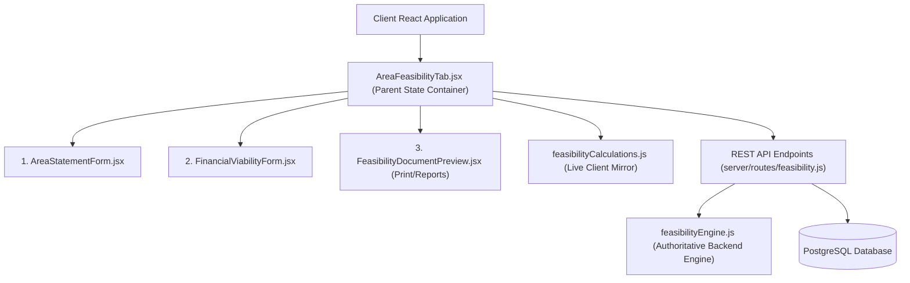

# DS16 Area & Financial Viability Rebuild
## Document 03: Existing System Audit & Architectural Assessment

**Project:** Design Studio 16 (DS16)  
**Module:** Project Details → Area & Financial Feasibility  
**Status:** Complete Authoritative Audit  
**Date:** November 2026

---

### 1. Executive Summary

This comprehensive audit examines the complete implementation of the **Area & Financial Feasibility** module in Design Studio 16 (DS16). The audit inspected database schemas, migrations, backend calculation engines (`feasibilityEngine.js`), API routes (`server/routes/feasibility.js`), frontend components (`AreaFeasibilityTab.jsx`, `AreaStatementForm.jsx`, `FinancialViabilityForm.jsx`, `FeasibilityDocumentPreview.jsx`), test suites, and reference project proposals (specifically the Manewada commercial/residential benchmark).

#### Core Audit Findings & Root Causes:
1. **Divergent Inlined Client Calculation Logic:** `AreaFeasibilityTab.jsx` previously maintained a 300+ line inlined `recalculateLive()` function that diverged mathematically from the backend engine in ancillary area, TDR splitting, and statutory items. This has been resolved by creating a zero-drift client calculation engine mirror (`client/src/utils/feasibilityCalculations.js`).
2. **Incorrect TDR Interpretation:** The legacy system treated Regular TDR and Slum TDR as independently selected road-width factors, leading to incorrect calculations (e.g. 12m road giving 0.65 regular + 0.325 slum = 0.975 total). The confirmed business rule dictates that Total TDR is determined by Road Width and divided equally into two 50% halves (e.g. 12m road gives 0.65 Total TDR, splitting into 0.325 Regular and 0.325 Slum). Regular TDR can be overridden by admin, and Slum TDR is automatically recalculated as the remainder.
3. **Non-Functional Override Buttons:** Cost items across Sections B (TDR), D (Civil Construction), E (Basement), F (Rent Compensation), and G (Stacked Parking) completely lacked UI override triggers. In addition, zero (`0`) values were rejected by truthiness checks (`if (parsed > 0)`).
4. **Unclear Cost of Plot Line:** The legacy system lacked an explicit inclusion toggle and conflated optional rates per sq m with direct lump-sum land acquisition cost.
5. **Missing Occupancy-Based Parking Engine:** The system lacked a structured implementation of UDCPR Table 8-B / 8-C for commercial carpet area, tenement size bands, visitor parking, and the 0.90 Nagpur authority factor.

---

### 2. Full Architecture & Component Breakdown

#### 2.1 Frontend Component Hierarchy
- `AreaFeasibilityTab.jsx`: Root state orchestrator managing the 4 sub-views, synchronized data fetching, optimistic recalculation via `feasibilityCalculations.js`, export generation (Excel and PDF), and calculation snapshots.
- `AreaStatementForm.jsx`: Captures Plot Area, DP deductions, Road Width, Gunthewari status, Building Use, 50/50 TDR configuration, Regular TDR override, and renders the 10-column Floor-wise P-Line distribution table.
- `FinancialViabilityForm.jsx`: Captures Ready Reckoner rates, Cost A / Cost B rates, Civil construction rate, Cost of Plot (Section H) with inclusion toggle, Statutory table (Section A), Sales inventory, and Controlled Override Modals.
- `FeasibilityDocumentPreview.jsx`: Renders the high-fidelity printable report with Tables 1 through 5, calculation provenance, and summary ROI cards.

#### 2.2 Authoritative Calculation Engine
- `server/services/feasibilityEngine.js`:
  - `ROAD_WIDTH_TOTAL_TDR_MAP`: Authoritative mapping of road widths (9m, 12m, 15m, 18m, 24m) to Total TDR factors.
  - `deriveTdrSplit()`: Derives 50/50 split and computes Slum TDR remainder when Regular TDR is overridden.
  - `distributeFsiAndAncillary()`: Equal FSI distribution with exact cent-level rounding reconciliation and use-based ancillary calculation (60% Residential, 80% Commercial).
  - `calculateParkingRequirements()`: UDCPR Table 8-B/8-C occupancy parking engine.
  - `calculateAreaMetrics()`: Primary FSI, dual TDR, permissible vs. proposed envelope, and 10-column floor rows.
  - `calculateFinancialMetrics()`: Statutory demand (Section A), TDR cost (Section B), minor expenses (Section C), civil construction (Section D), basement (Section E), rent (Section F), stacked parking (Section G), plot cost (Section H), sales realization, net profit, and ROI.

---

### 3. Database Schema & Migration Assessment

Existing production tables:
- `project_area_statements`: Baseline plot dimensions, FSI factors, road width, total/regular/slum TDR, building use, gunthewari status, parking configuration, regulatory profile.
- `project_area_floors`: Level name, height, FSI area, ancillary area, P-Line area, lobby area, built-up for sale, units, area per unit, usage type, and override flags.
- `project_financial_viabilities`: RR rate, Cost A/B rates, civil rate, basement rate/area, rent, stacked parking, lump-sum plot cost, `is_cost_of_plot_included` flag, overrides JSONB.
- `project_statutory_charges`: 12 standard regulatory charges with charge codes, calculation basis, rates, caps, amounts, and enabled flags.
- `project_salable_units`: Unit inventory types, carpet area, super built-up loading, developer units, landowner units, and selling rates.
- `project_feasibility_snapshots`: Immutable historical snapshots of full area and financial state.
- `feasibility_audit_logs`: Audit trail tracking all parameter mutations with editor provenance.

All migrations (039 and 040) have been deployed using additive, backward-compatible DDL. No production tables were dropped, truncated, or reseeded.
