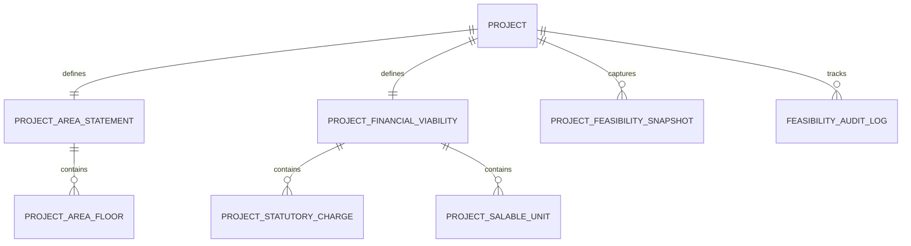

# DS16 Area & Financial Feasibility Rebuild
## Document 04: Authoritative Domain Data Model Specification

**Project:** Design Studio 16 (DS16)  
**Module:** Project Details → Area & Financial Feasibility  
**Status:** Implemented & Verified Schema  
**Date:** November 2026

---

### 1. Conceptual Model & Single Source of Truth

The entire DS16 Area & Financial Feasibility module operates on **one shared project feasibility data model**. The four sub-tabs (`Area Statement`, `Financial Viability`, `Project Summary`, `Report Preview`) do not maintain independent copies of project data; they read from and mutate the authoritative PostgreSQL database records and synchronize via `AreaFeasibilityTab.jsx`.

---

### 2. Physical Database Tables & Data Dictionary

#### 2.1 Table: `project_area_statements`
Primary configuration for land dimensions, regulatory classification, and development potential.

| Column | Type | Nullable | Default | Description & Constraints |
|---|---|---|---|---|
| `id` | SERIAL | NO | — | Primary Key |
| `project_id` | INTEGER | NO | — | FK -> `projects(id)` ON DELETE CASCADE (Unique) |
| `plot_area_sqm` | NUMERIC(12,4) | NO | 0.00 | Gross surveyed plot area in square meters |
| `city_survey_area_sqm` | NUMERIC(12,4) | YES | NULL | Area as per City Survey Record (PR Card) |
| `site_area_sqm` | NUMERIC(12,4) | YES | NULL | Actual demarcated on-site physical area |
| `dp_deductions_sqm` | NUMERIC(12,4) | YES | 0.00 | Deductions for Development Plan roads/amenities |
| `existing_builtup_area_sqm` | NUMERIC(12,4) | YES | 0.00 | Area of existing retained structures on plot |
| `margin_meters` | NUMERIC(6,2) | YES | NULL | Statutory open margins around building |
| `road_width_m` | NUMERIC(6,2) | YES | 12.00 | Access street width: strictly 9, 12, 15, 18, or 24 |
| `basic_fsi_factor` | NUMERIC(6,3) | YES | 1.100 | Statutory base Floor Space Index entitlement |
| `paid_fsi_factor` | NUMERIC(6,3) | YES | 0.500 | Paid / Premium FSI entitlement |
| `total_tdr_factor` | NUMERIC(6,3) | YES | 0.650 | Total TDR factor derived from road width |
| `regular_tdr_factor` | NUMERIC(6,3) | YES | 0.325 | Regular TDR factor (default 50% of Total TDR) |
| `slum_tdr_factor` | NUMERIC(6,3) | YES | 0.325 | Slum TDR factor (derived remainder) |
| `is_gunthewari` | BOOLEAN | YES | FALSE | Flag for Gunthewari Scheme regularized plots |
| `building_use` | VARCHAR(50) | YES | 'Residential' | Usage: 'Residential', 'Commercial', 'Mixed Use' |
| `ancillary_residential_pct` | NUMERIC(5,2) | YES | 0.60 | Approved residential ancillary percentage (60%) |
| `ancillary_commercial_pct` | NUMERIC(5,2) | YES | 0.80 | Approved commercial ancillary percentage (80%) |
| `dividing_factor` | NUMERIC(6,3) | YES | 1.600 | Ancillary conversion factor |
| `total_proposed_pline_override_sqm` | NUMERIC(12,4) | YES | NULL | Manual project-level proposed P-Line target override |
| `is_proposed_pline_overridden` | BOOLEAN | YES | FALSE | Flag indicating project P-Line override is active |
| `proposed_pline_override_reason` | TEXT | YES | NULL | Architect's justification for project P-Line override |
| `parking_config` | JSONB | YES | '{}' | Parameters for UDCPR Table 8-B/8-C parking calculations |
| `regulatory_profile` | VARCHAR(50) | YES | 'UDCPR_2020' | Governing regulatory code profile |

#### 2.2 Table: `project_area_floors`
Floor-by-floor breakdown of the building configuration.

| Column | Type | Nullable | Default | Description & Constraints |
|---|---|---|---|---|
| `id` | SERIAL | NO | — | Primary Key |
| `area_statement_id` | INTEGER | NO | — | FK -> `project_area_statements(id)` ON DELETE CASCADE |
| `floor_name` | VARCHAR(100) | NO | — | Display label (e.g., '1st Floor - Commercial') |
| `floor_key` | VARCHAR(50) | YES | NULL | Unique machine slug (e.g., 'floor_1') |
| `floor_order` | INTEGER | YES | 0 | Vertical level sequence index |
| `floor_type` | VARCHAR(50) | YES | 'habitable' | Category: 'habitable', 'parking', 'terrace', 'service' |
| `usage_type` | VARCHAR(50) | YES | 'Residential' | Usage classification: 'Residential', 'Commercial', etc. |
| `height_meters` | NUMERIC(6,2) | YES | 3.00 | Floor-to-floor clear vertical height in meters |
| `fsi_area_sqm` | NUMERIC(12,4) | YES | 0.00 | Net FSI area consumed on this floor |
| `ancillary_area_sqm` | NUMERIC(12,4) | YES | 0.00 | Ancillary area consumed on this floor |
| `pline_area_sqm` | NUMERIC(12,4) | YES | 0.00 | Gross P-Line area on this floor: `FSI + Ancillary` |
| `is_pline_overridden` | BOOLEAN | YES | FALSE | True if floor P-Line was manually adjusted |
| `pline_override_reason` | TEXT | YES | NULL | Justification for floor P-Line adjustment |
| `lobby_area_sqm` | NUMERIC(12,4) | YES | 0.00 | Common circulation area (default: 15% of P-Line) |
| `is_lobby_overridden` | BOOLEAN | YES | FALSE | True if lobby area diverges from 15% default |
| `builtup_for_sale_sqm` | NUMERIC(12,4) | YES | 0.00 | Net saleable floor builtup: `P-Line - Lobby` |
| `no_of_units` | INTEGER | YES | 1 | Number of distinct residential or commercial units |
| `area_for_1_unit` | NUMERIC(12,4) | YES | 0.00 | Average unit area: `Builtup for Sale / no_of_units` |
| `rate_per_sqm` | NUMERIC(12,2) | YES | 0.00 | Anticipated selling rate per sq m for this floor |

#### 2.3 Table: `project_financial_viabilities`
Financial assumptions, Ready Reckoner rates, construction costs, and controlled overrides.

| Column | Type | Nullable | Default | Description & Constraints |
|---|---|---|---|---|
| `id` | SERIAL | NO | — | Primary Key |
| `project_id` | INTEGER | NO | — | FK -> `projects(id)` ON DELETE CASCADE (Unique) |
| `rr_rate_per_sqm` | NUMERIC(12,2) | YES | 24340.00 | Government published Ready Reckoner land rate |
| `estimated_cost_a_rate` | NUMERIC(12,2) | YES | 15000.00 | Benchmark Cost A rate per sq m (drives deposits) |
| `estimated_cost_b_rate` | NUMERIC(12,2) | YES | 26620.00 | Benchmark Cost B rate per sq m (drives labour cess) |
| `cost_of_construction_rate` | NUMERIC(12,2) | YES | 20000.00 | Actual civil construction rate per sq m |
| `cost_of_plot` | NUMERIC(14,2) | YES | 0.00 | Direct lump-sum land acquisition amount (Section H) |
| `is_cost_of_plot_included` | BOOLEAN | YES | TRUE | Toggle: include/exclude plot cost from total project cost |
| `tdr_purchase_factor` | NUMERIC(5,2) | YES | 0.55 | Percentage of RR rate for purchasing TDR (default: 55%) |
| `basement_area_sqm` | NUMERIC(12,2) | YES | 0.00 | Substructure / basement area in sq m |
| `basement_rate_per_sqm` | NUMERIC(12,2) | YES | 5500.00 | Construction rate for basement area |
| `period_months` | VARCHAR(50) | YES | '18' | Project execution timeframe in months |
| `rent_tenements` | INTEGER | YES | 0 | Number of eligible tenant households |
| `rent_per_tenement_per_month`| NUMERIC(12,2) | YES | 0.00 | Monthly transit rent compensation per tenement |
| `stacked_parking_slots` | INTEGER | YES | 0 | Number of mechanical stacked car parking slots |
| `stacked_parking_cost_per_slot`| NUMERIC(12,2) | YES | 250000.00 | Mechanical equipment supply & install cost per slot |
| `overrides` | JSONB | YES | '{}' | Controlled admin overrides dictionary with audit metadata |

#### 2.4 Table: `project_statutory_charges`
Individual local authority (NMC / Municipal) statutory demand charges.

| Column | Type | Nullable | Default | Description & Constraints |
|---|---|---|---|---|
| `id` | SERIAL | NO | — | Primary Key |
| `financial_viability_id` | INTEGER | NO | — | FK -> `project_financial_viabilities(id)` ON DELETE CASCADE |
| `charge_code` | VARCHAR(50) | NO | — | Standard charge identifier (e.g. 'ANCILLARY_CHARGES') |
| `charge_name` | VARCHAR(150) | NO | — | User-facing display title |
| `calculation_basis` | VARCHAR(50) | YES | NULL | Formula formula type: 'pct_of_rr', 'pct_of_cost_a', etc. |
| `rate_multiplier` | NUMERIC(10,4) | YES | NULL | Mathematical multiplier (e.g., 0.10 for 10%) |
| `max_cap` | NUMERIC(12,2) | YES | NULL | Upper monetary ceiling (e.g., ₹75,000 for Security Deposit) |
| `rr_percentage` | NUMERIC(6,2) | YES | NULL | Percentage of Ready Reckoner rate applied |
| `amount` | NUMERIC(14,2) | YES | 0.00 | Calculated or overridden effective amount |
| `is_enabled` | BOOLEAN | YES | TRUE | Toggle to include/exclude item from Total Demand A |
| `is_custom` | BOOLEAN | YES | FALSE | True if created manually as an ad-hoc charge |
| `is_deleted` | BOOLEAN | YES | FALSE | Soft-deletion flag |
| `order_index` | INTEGER | YES | 0 | Display sorting index |

#### 2.5 Table: `project_salable_units`
Saleable residential and commercial inventory.

| Column | Type | Nullable | Default | Description & Constraints |
|---|---|---|---|---|
| `id` | SERIAL | NO | — | Primary Key |
| `financial_viability_id` | INTEGER | NO | — | FK -> `project_financial_viabilities(id)` ON DELETE CASCADE |
| `unit_type` | VARCHAR(100) | NO | — | Name / typology (e.g., '2BHK Luxury Flat') |
| `carpet_area_sqm` | NUMERIC(10,2) | YES | 0.00 | RERA carpet area in square meters |
| `super_buildup_loading_sqft` | NUMERIC(10,2) | YES | 300.00 | Common loading area in square feet |
| `unit_count` | INTEGER | YES | 1 | Total number of units of this typology |
| `landowner_unit_count` | INTEGER | YES | 0 | Units allocated to landowner (excluded from developer receipts) |
| `rate_per_sqft` | NUMERIC(12,2) | YES | 6000.00 | Sale pricing rate per square foot super built-up |
| `order_index` | INTEGER | YES | 0 | Display sequence index |
