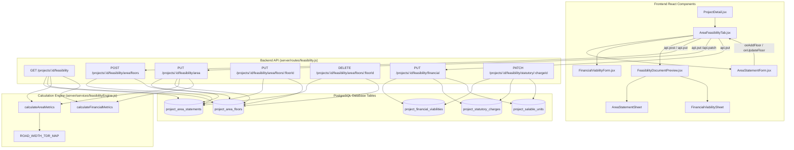

# DS16 — Area Statement & Financial Viability Input Refinement
## Technical Audit & Component Dependency Map

**Document ID**: `DS16-AUDIT-FEASIBILITY-002`  
**Date**: November 19, 2026  
**Status**: Ready for Architectural Review & Clarification  

---

## 1. Executive Summary

This audit assesses the current state of the **Area Statement** and **Financial Viability** modules in DS16. It maps all components, API endpoints, database tables, and calculation dependencies relevant to the requested refinements:
1. Simplifying **Plot & Survey Baseline Inputs** to retain only **Plot Area (sq m)**.
2. Formally deriving **Regular TDR** and **Slum TDR** from **Road Width** and **Plot Classification**.
3. Diagnosing and resolving the **Add Floor** button failure, component state, persistence, and validation.
4. Sourcing floor-wise records directly into the **Financial Viability** interface with a unified data pipeline and auditing the proposed **Cost for 1 Unit** column.
5. Auditing the **Direct Development & Civil Construction Costs** section to establish all report and net profit calculation dependencies prior to UI removal.

---

## 2. Component and Dependency Map



---

## 3. Detailed Audit by Requirement

### 3.1 Plot & Survey Baseline Inputs
**Source Files**:
- `client/src/components/projects/feasibility/AreaStatementForm.jsx` (Lines 105–159)
- `client/src/components/projects/feasibility/FeasibilityDocumentPreview.jsx` (Lines 134–154)
- `server/services/feasibilityEngine.js` (Lines 26–29, 72–74)
- `server/routes/feasibility.js` (Lines 55–60, 155–230)
- `server/db/migrations/028_project_timeline_and_feasibility.sql` (Columns `dp_deductions_sqm`, `existing_builtup_area_sqm`, `margin_meters`)

#### Existing Field Dependencies:
| Field | UI Status | Database Column | Calculation Dependency | Impact of UI Removal |
| :--- | :--- | :--- | :--- | :--- |
| **Plot Area (sq m)** | **RETAINED** | `plot_area_sqm` | Primary basis for all FSI, TDR, and plot costs. | Remains editable and required. |
| **D.P. Road / Reservation Deductions** | **REMOVE FROM UI** | `dp_deductions_sqm` | `plotableAreaSqm = Math.max(0, plotArea - dpDeductions)`. | When removed from UI, defaults to `0.00`. `plotableArea = plotArea`. Zero calculation errors. |
| **Existing Built-up Area Deduction** | **REMOVE FROM UI** | `existing_builtup_area_sqm` | Read into variable `existingBuiltup` but **not used** in any FSI or cost formula. | Zero impact on calculations. Preserved in database schema. |
| **Margin / Setback Requirement** | **REMOVE FROM UI** | `margin_meters` | Informational architectural field. Stored in DB, never referenced in financial or area math. | Zero impact on calculations. Preserved in database schema. |

---

### 3.2 Building Use, Road Width & Dual TDR Determination
**Source Files**:
- `client/src/components/projects/feasibility/AreaStatementForm.jsx` (Lines 20–71, 161–285)
- `server/services/feasibilityEngine.js` (Lines 11–17, 37–61)
- `server/routes/feasibility.js` (Lines 185–196)

#### Current Implementation & Authoritative Road Width Matrix:
```javascript
const ROAD_WIDTH_TDR_MAP = {
  9:  { regular: 0.40, gunthewari: 0.20 },
  12: { regular: 0.65, gunthewari: 0.325 },
  15: { regular: 0.80, gunthewari: 0.40 },
  18: { regular: 0.90, gunthewari: 0.45 },
  24: { regular: 1.10, gunthewari: 0.50 }
};
```

#### Behavioral Changes Required:
1. **Read-Only / Derived Factors**: `Regular TDR Factor` and `Slum TDR Factor` must not be arbitrary manual text inputs; they must automatically update when `road_width_m` or `is_gunthewari` changes.
2. **Display**: The input panel will clearly display the calculated factors, badge indicator, and combined TDR factor.
3. **Unsupported Road Widths**: The selector restricts choices strictly to `[9, 12, 15, 18, 24]`. Any unrecognized width leaves TDR as `0.00` and displays a validation alert rather than guessing or interpolating.

---

### 3.3 Investigation of the "Add Floor" Button Failure
**Source Files**:
- `client/src/components/projects/feasibility/AreaStatementForm.jsx` (Lines 300–309)
- `client/src/components/projects/feasibility/AreaFeasibilityTab.jsx` (Lines 202–223)
- `server/routes/feasibility.js` (Lines 259–325)

#### Root Causes Identified:
1. **Unapplied Migration on Production Server**: The VPS was missing migration `030`, causing `GET /feasibility` to fail (`column does not exist`). When `GET /feasibility` failed, `project_area_statements` was not initialized in the database. When the user clicked "Add Floor", `POST /area/floors` executed:
   ```sql
   SELECT id FROM project_area_statements WHERE project_id = $1
   ```
   and returned `404: Area statement not found`.
2. **Missing Backend Self-Healing / Auto-Initialization**: `POST /area/floors` did not verify or create `project_area_statements` if missing.
3. **No Debounce / Concurrency Lock on Frontend**: `handleAddFloor` lacked an `isAddingFloor` loading guard, allowing multiple clicks to fire simultaneously or fail silently.
4. **Error Handling Opacity**: The frontend catch block only called `toast.error('Failed to add floor')` without extracting the backend error response (`err.response?.data?.error`).

#### Corrective Architecture:
- Add atomic self-healing to `POST /area/floors`: If `project_area_statements` is missing for the project, automatically initialize it from the project baseline before inserting the floor.
- Add `isAddingFloor` loading state to disable the button during network in-flight requests.
- Floor naming convention: Default to `Ground Floor` for the first floor, followed by `1st Floor`, `2nd Floor`, `3rd Floor`, etc., with strictly monotonic `floor_order`.
- Auto-calculate 15% lobby on creation (`is_lobby_overridden: false`), and automatically compute `area_for_1_unit = builtup_for_sale / no_of_units`.

---

### 3.4 Sourcing Floor-wise Records into Financial Viability & "Cost for 1 Unit"
**Source Files**:
- `client/src/components/projects/feasibility/FinancialViabilityForm.jsx` (Lines 351–440)
- `client/src/components/projects/feasibility/AreaFeasibilityTab.jsx`
- `server/services/feasibilityEngine.js` (Lines 420–448)

#### Architecture:
1. **Single Source of Truth**:
   The Financial Viability component will directly consume the same `floors` state array from `AreaFeasibilityTab.jsx` that is managed by the Area Statement.
2. **Floor Table in Financial Viability**:
   Displays the 7 Area Statement columns:
   - Floor Level
   - Height (m)
   - P-Line Area (sq m)
   - Lobby Area (sq m)
   - Built-up for Sale (sq m)
   - No. Of Units
   - Area For 1 Unit (sq m)
   Plus the new 8th column:
   - **Cost for 1 Unit (₹)**
3. **Synchronization**:
   Edits to floors in the Area Statement immediately reflect in Financial Viability and vice versa without duplicating database rows.

---

### 3.5 Direct Development & Civil Construction Costs Audit
**Source Files**:
- `client/src/components/projects/feasibility/FinancialViabilityForm.jsx` (Lines 178–295)
- `server/services/feasibilityEngine.js` (Lines 391–419)
- `client/src/components/projects/feasibility/FeasibilityDocumentPreview.jsx` (Financial Viability Sheet Table 2)

#### Dependency Audit:
| Field | Database Column | Usage in `calculateFinancialMetrics` | Usage in Financial Report Preview |
| :--- | :--- | :--- | :--- |
| **Construction Rate (₹/sq m)** | `cost_of_construction_rate` | `costOfConstructionD = effectivePlineSqm * constRate` | Section D: Civil Construction Cost |
| **Plot Purchase Rate (₹/sq m)** | `cost_of_plot_rate_per_sqm` | `costOfPlotH = plotArea * plotCostRate` | Section H: Plot Cost |
| **Cost of Plot Lump Sum (₹)** | `cost_of_plot` | Overrides rate calculation if $> 0$ | Section H: Plot Cost |
| **Basement Area (sq m)** | `basement_area_sqm` | `costOfBasementE = basementArea * basementRate` | Section E: Basement Cost |
| **Rent during Construction** | `rent_tenements`, `rent_per_tenement_per_month`, `rent_months` | `rentCostF = tenements * rentRate * months` | Section F: Rent Compensation |
| **Stacked Parking** | `stacked_parking_slots`, `stacked_parking_cost_per_slot` | `stackedParkingCostG = slots * costPerSlot` | Section G: Parking Mechanical Cost |

> [!IMPORTANT]
> **Total Project Cost** is defined as:
> $$\text{Total Cost} = \text{Statutory Demand (A)} + \text{TDR Purchase (B)} + \text{Expenses (C)} + \text{Construction (D)} + \text{Basement (E)} + \text{Rent (F)} + \text{Parking (G)} + \text{Plot (H)} + \text{Infra} + \text{Interest}$$
> If the UI inputs for Sections D–H are removed without clarification, the report and net profit calculations will either:
> 1. Continue computing using existing/default values stored in the project record, OR
> 2. Drop to zero if the fields are cleared, breaking the financial feasibility analysis.
> 
> Per Section 7 of the user prompt, we do **not** delete underlying database fields or break calculations without explicit confirmation.
